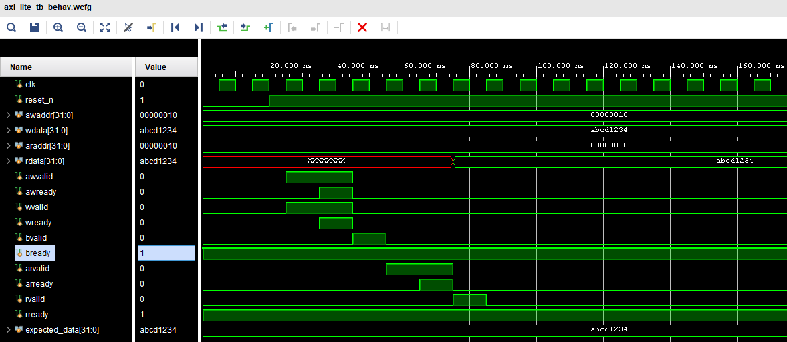

# AXI4-Lite Protocol Checker

A SystemVerilog verification environment for an AXI4-Lite register-file DUT,
built incrementally across six stages. The project demonstrates industry-standard
verification practices: 5-channel monitoring, an associative-array scoreboard,
SVA protocol assertions, functional coverage, back-pressure testing, and a
dedicated negative-protocol testbench.

---

## Overview

AXI4-Lite is a simplified subset of the ARM AMBA AXI4 bus protocol designed for
single-beat (non-burst) register-level transactions. It uses five independent
handshake channels: AW (write address), W (write data), B (write response),
AR (read address), and R (read data).

This project verifies a simplified AXI4-Lite register-file slave (DUT) by:
- Observing all five channels via a passive monitor.
- Comparing observed read data against an in-memory reference model (scoreboard).
- Checking structural protocol rules through SystemVerilog Assertions (SVA).
- Measuring verification completeness via functional coverage.
- Stress-testing the DUT under legitimate master back-pressure.
- Deliberately injecting protocol violations and verifying the correct assertions fire.

---

## Repository Structure

```
AXI4-Lite-Protocol-Checker/
├── rtl/
│   └── axi_lite_dut.sv         # DUT: 256-word register-file slave
├── tb/
│   ├── axi_lite_tb.sv          # Positive testbench (SVA + coverage)
│   ├── axi_lite_neg_tb.sv      # Negative protocol violation testbench
│   ├── axi_lite_driver.sv      # Master driver with back-pressure
│   ├── axi_lite_monitor.sv     # 5-channel passive transaction monitor
│   └── axi_lite_scoreboard.sv  # Associative-array reference model
├── sim/
│   ├── run_regression.sh       # Regression runner script (WSL/bash)
│   └── wave.do                 # Vivado waveform configuration
├── docs/
│   └── assets/
│       └── AXI_lite_write_read_waveform.png
├── Makefile                    # Build & run Makefile
├── run_regression.sh           # Root-level regression entrypoint
├── .gitignore
└── README.md
```

---

## Verification Architecture

```
+-------------------+        +---------------------+
|  tb/axi_lite_tb   |        | tb/axi_lite_neg_tb  |
| (Positive Tests)  |        |  (Negative Tests)   |
+-------------------+        +---------------------+
         |                              |
   +-----+-----+            +----------+----------+
   |           |            |          |          |
+--------+  +------+     +------+  +-------+  +------+
| Driver |  | DUT  |     | DUT  |  | Mon.  |  | SB   |
+--------+  +------+     +------+  +-------+  +------+
                |                      
           +--------+    
           | Mon.   |    
           +--------+    
                |
           +--------+    
           |  SB    |    
           +--------+    

SVA Assertions: 13 properties in tb/axi_lite_tb.sv (VALID/READY stability,
                address/data stability, no-X checks, response ordering).

Functional Coverage: Covergroup in tb/axi_lite_tb.sv (handshakes, address
                     ranges, data patterns, stall/backpressure, cross).
```

---

## Features

- **5-Channel Monitoring**: All AW, W, B, AR, R channels passively observed.
- **Associative-Array Scoreboard**: Reference memory mirrors DUT state; all reads
  are compared against predicted values without hardcoded expected data.
- **13 SVA Protocol Assertions**: VALID stability, address/data stability,
  no-X/Z checks, write-response ordering, read-response ordering.
- **Functional Coverage**: Handshakes, address ranges (min/max), data patterns
  (all-zeros, all-ones, 0xAAAAAAAA, 0x55555555), backpressure stall bins,
  simultaneous AW/W cross coverage (100% closed).
- **Legitimate Back-Pressure**: Driver introduces 2-cycle delays on BREADY and
  RREADY, exercising the B/R stability assertions and stall coverage bins.
- **Negative Protocol Testing**: 4 targeted protocol violations injected and
  each detected by its intended assertion; gracefully tracked without crashing.
- **Automated Regression**: `run_regression.sh` and `Makefile` compile, elaborate,
  simulate, collect coverage, and exit with 0 (PASS) or 1 (FAIL).
- **Waveform Debugging**: `sim/wave.do` configures all 5 AXI channels and scoreboard
  signals for Vivado XSIM waveform view.

---

## Test Scenarios

### Positive Tests (`tb/axi_lite_tb.sv` + `tb/axi_lite_driver.sv`)

| # | Address    | Write Data   | B-channel delay | R-channel delay |
|---|------------|--------------|-----------------|-----------------|
| 1 | 0x00000000 | 0x00000000   | 2 cycles        | 2 cycles        |
| 2 | 0x000000FF | 0xFFFFFFFF   | 2 cycles        | 2 cycles        |
| 3 | 0x000000AA | 0xAAAAAAAA   | 2 cycles        | 2 cycles        |
| 4 | 0x00000055 | 0x55555555   | 2 cycles        | 2 cycles        |

Each transaction: write (AW+W), wait for B response, read (AR), wait for R response.
The 2-cycle back-pressure on BREADY/RREADY exercises stability assertions and stall bins.

### Negative Tests (`tb/axi_lite_neg_tb.sv`)

| # | Violation              | Intended Assertion     | Expected Result |
|---|------------------------|------------------------|-----------------|
| 1 | AWVALID dropped early  | a_awvalid_stable       | DETECTED        |
| 2 | AWADDR changed mid-txn | a_awaddr_stable        | DETECTED        |
| 3 | WVALID dropped early   | a_wvalid_stable        | DETECTED        |
| 4 | WDATA changed mid-txn  | a_wdata_stable         | DETECTED        |

---

## Verification Results

### Positive Testbench
- Transactions: 4 write/read pairs
- Scoreboard: 4 writes tracked, 4 reads checked, **4 PASS, 0 FAIL**
- SVA assertions: 0 unexpected failures
- Exit code: 0

### Negative Testbench
- 4 violations injected, **4 intended assertions detected**
- No unrelated assertions fired
- Exit code: 0

### Functional Coverage (Vivado XSIM `xcrg` report)
| Coverage Point          | Covered / Total Bins | Percent |
|-------------------------|----------------------|---------|
| cp_aw_handshake         | 1 / 1                | 100%    |
| cp_w_handshake          | 1 / 1                | 100%    |
| cp_b_handshake          | 1 / 1                | 100%    |
| cp_ar_handshake         | 1 / 1                | 100%    |
| cp_r_handshake          | 1 / 1                | 100%    |
| cp_awaddr (min/max)     | 2 / 2                | 100%    |
| cp_araddr (min/max)     | 2 / 2                | 100%    |
| cp_wdata (4 patterns)   | 4 / 4                | 100%    |
| cp_rdata (4 patterns)   | 4 / 4                | 100%    |
| cp_aw_stall             | 1 / 1                | 100%    |
| cp_w_stall              | 1 / 1                | 100%    |
| cp_b_stall              | 1 / 1                | 100%    |
| cp_ar_stall             | 1 / 1                | 100%    |
| cp_r_stall              | 1 / 1                | 100%    |
| cr_aw_w_simul (cross)   | 1 / 1                | 100%    |
| **Overall Coverage**    | **21 / 21 bins**     | **100%**|

---

## Waveform Demonstration



---

## Simulation / Usage

### Option 1: Using the Automated Regression Script (Recommended)

```bash
# From repository root:
chmod +x run_regression.sh
./run_regression.sh

# To clean artifacts and run clean regression:
./run_regression.sh --clean
```

### Option 2: Using Makefile

```bash
make all    # Runs positive + negative tests + generates coverage report
make sim    # Runs positive testbench only
make neg    # Runs negative testbench only
make cov    # Generates text coverage report
make clean  # Cleans generated simulation artifacts
```

### Option 3: Manual CLI Execution (Vivado XSIM)

#### Positive Testbench:
```bash
xvlog -sv rtl/axi_lite_dut.sv tb/axi_lite_driver.sv tb/axi_lite_monitor.sv \
          tb/axi_lite_scoreboard.sv tb/axi_lite_tb.sv
xelab -debug all work.axi_lite_tb -s axi_sim
xsim axi_sim -runall
```

#### Negative Testbench:
```bash
xvlog -sv rtl/axi_lite_dut.sv tb/axi_lite_monitor.sv \
          tb/axi_lite_scoreboard.sv tb/axi_lite_neg_tb.sv
xelab -debug all work.axi_lite_neg_tb -s axi_neg_sim
xsim axi_neg_sim -runall
```

#### Interactive Waveform GUI:
```bash
xsim axi_sim -gui
# In Tcl console:
source sim/wave.do
run 2500ns
```

---

## Tools

- **Simulator**: AMD/Xilinx Vivado XSIM (tested with v2025.2)
- **Language**: SystemVerilog (IEEE 1800-2017)
- **Environment**: Linux / WSL2 (Ubuntu) / Windows compatible

---

## DUT Limitations

This is a **simplified educational DUT**, not a full production AXI4-Lite slave:
- No `WSTRB` (write strobe) — all 4 bytes are written unconditionally.
- No `BRESP` / `RRESP` (response status codes).
- No `AWPROT` / `ARPROT` (protection signals).
- Address decode uses only bits [7:0] (256-word depth).
- AW and W channels are expected simultaneously.
- W-before-AW ordering is not supported.

Verification assertions and coverage reflect what this DUT actually implements.
No coverage was artificially forced to 100% by relaxing correctness criteria.

---

## Author

[Ansh Verma](https://github.com/ansh07verma)